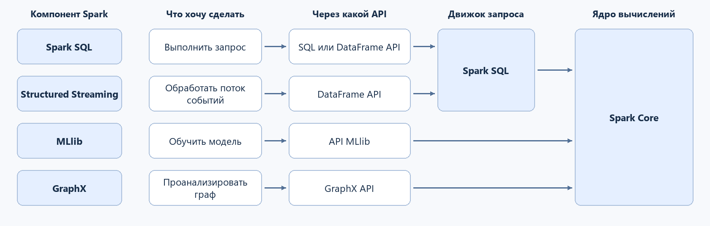

# Компоненты Spark

Как уже было упомянуто выше, движок Spark предлагает 4 основных компонента,
предназначенных для различных задач:

| Тип задачи   | Для чего подходит                             |
| ------------ |-----------------------------------------------|
| **SQL**      | SQL-запросы, аналитика, таблицы               |
| **Стриминг** | Обработка потока микропакетами (по умолчанию) |
| **ML**       | Машинное обучение (модели)                    |
| **Графы**    | Работа с графами (сети)                       |

Фундамент вычислений является универсальным:
- API - способ формулировки инструкций для решения поставленной задачи   
- Ядро отвечает за выполнение распределенных вычислений

