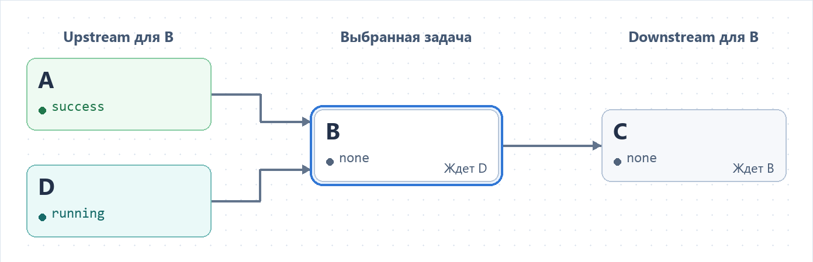

# 1.1 Роль Airflow для data-пайплайнов

Особенности Apache Airflow:
- Оркестратор - руководит выполнением задач (кукловод, дирижер, менеджер). Иногда также и выполняет задачи (воркер).
- Батч-ориентированная платформа для создания пайплайнов
- Пайплайны запускается по расписанию либо вручную
- Относительно низкий порог входа (субъективно)
- Основной язык оркестратора - Python: на нем пишется DAG. При этом задачи могут вызывать скрипт на любом подходящем языке: Bash, Python, SQL и другие.

## Пайплайны в Airflow

>Пайплайн - это ацикличный ориентированный граф (DAG) задач:
>
>Задачи - вершины
>
>Зависимости между задачами - ребра с соответственным направлением
>
>>*В Airflow **DAG** = "пайплайн".*

Отсутствие циклов здесь фундаментально важно. При наличии цикла Airflow бы не понял, какую задачу из вершин внутри цикла начинать первой - т.н. deadlock (взаимоблокировка). При наличии циклов в предлагаемом графе Airflow обнаруживает их и вызывает ошибку. Данное ограничение не распространяется на содержимое задач.

Благодаря такому представлению задачи можно упрощенно описать так:
- по характеру выполнения: открытые (ожидают выполнения), выполняемые, закрытые (выполнены либо пропущены)
- относительно выбранной задачи выделяются upstream-задачи (предыдущие) и downstream-задачи (последующие)

На основе этих характеристик Airflow принимает решения и руководит задачами.

*Рисунок 1.1: Зависимости и состояния DAG на примере одного запуска. Стрелка идет от задачи, от которой зависит следующая.*

В данном случае для B задачи A и D являются upstream, С - downstream.
Задача A является выполненной, D - выполняемой, B и C - ожидают выполнения.

## Почему пайплайны?

Использование пайплайна, состоящего из атомарных задач, имеет несколько преимуществ перед последовательными скриптами:
- Упрощает проектирование, отладку, обработку ошибок
- Позволяет запускать независимые задачи параллельно
- В случае падения задачи и последующем исправлении не нужно запускать весь DAG заново. Если есть успешно выполненная ветка (часть DAG), её результат сохранился и его можно использовать, тогда после восстановления её работу можно не повторять - достаточно перезапустить упавшие задачи.
