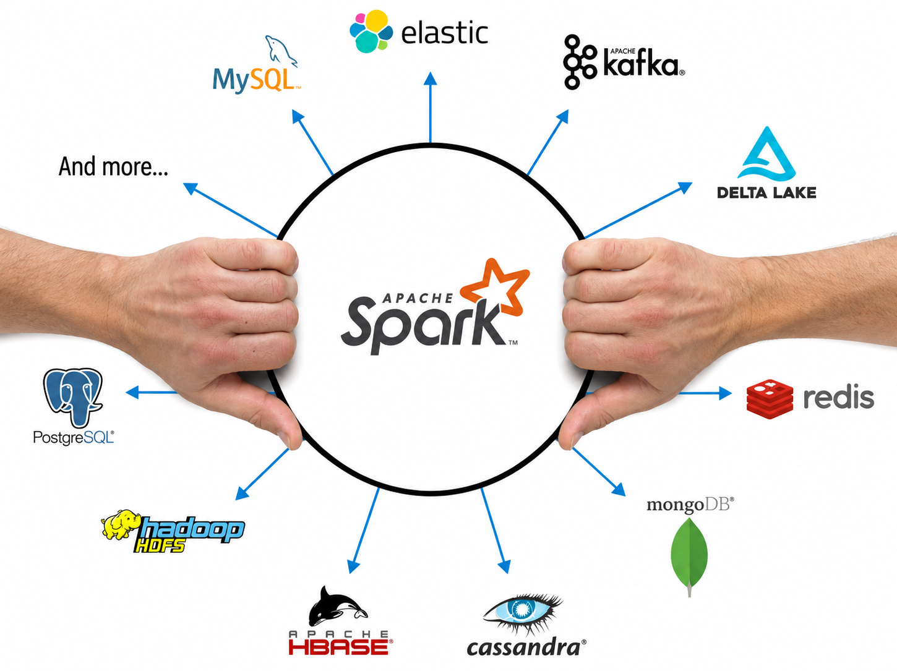

# 1.1 Что такое Spark

Spark - это движок для работы с данными. Ключевые особенности:
- Оптимизирован в первую очередь для обработки больших данных - терабайты, петабайты (нижнего порога на объем нет).
- Умеет распределять вычисления между исполнителями.
## Философия Spark

Выделяют 4 фундаментальные свойства:
- Скорость
- Простота использования
- Универсальность
- Расширяемость
### Скорость

Spark по-настоящему **быстрый** благодаря синергии:
- Использования кэша (RAM) 
- Оптимальных вычислений
#### Кэш
Одна из киллер-фичей Spark - хранение кэша в RAM (оперативной памяти) - позволяет переиспользовать промежуточные результаты расчета. Это приводит к экономии на повторные чтение и вычисления (если они есть).

#### Оптимизация вычислений
Разработчики Spark подстроились под современные реалии и учли стоимость ресурсов (дешевая RAM и CPU) и технологии (кэш в RAM, возможность использовать несколько ядер и многопоточность), чтобы оптимизировать вычисления.

Благодаря этому они сделали движок умным "под капотом": он знает, как сделать задачу лучше - быстрее и оптимальнее. Он использует несколько важных фичей:
1. **Ленивые вычисления.**
   Часть операций являются **преобразованиями** - они описывают вычисления (похоже на бэклог и todo-list). Расчет запускается только при наличии **действия** (просим обработать бэклог).
2. Из преобразований формируется **логический план запроса**.
3. При запуске расчета Spark оптимизирует план и разбивает запрос на задачи, причем может выполнять их параллельно.
4. Некоторые операции объединяются в один цикл, что сокращает расходы ресурсов.

### Простота использования

Несмотря на сложную реализацию и работу с огромными размерами данных, со Spark легко работать благодаря этим принципам:
- RDD - распределенная коллекция - является низким уровнем абстракции. В RDD пользователь имеет дело с распределенной коллекцией.
- Поверх неё надстроены структурированные API - датасеты и датафреймы. Здесь пользователь работает со структурой данных в другом интерфейсе: со столбцами и типами.
- Существуют всего 2 типа операций над данными: преобразования (ленивые) и действия (запускают вычисления).
  >Некоторые методы пишутся одинаково и могут иметь разный тип в зависимости от употребления. Пример с `count()`:
  >```python
  >df.groupBy("region").count() # преобразование
  >df.count() # действие
  >```
- В зависимости от задачи можно выбрать привычный поддерживаемый язык. Например, для DataFrame API доступны Python, Scala, Java и R.
### Универсальность

- Spark позволяет работать с данными для разных типов задач (ML, SQL, стриминг и графы). Можно работать одновременно над несколькими типами задач в одном движке.
- Методы и библиотеки некоторых API похожи имеют общий движок. Например, SQL-запрос к таблице можно описать в PySpark с помощью методов DataFrame. Результаты будут эквивалентны и оба будут выполняться на движке Spark SQL.
### Расширяемость

Spark отвечает только за вычисления, причем движок приспособлен для любого из поддерживаемых источников (Hadoop, MongoDB, Hive, Kafka, S3 и т.д.). 

Тип хранения выбирается исходя из задачи. При этом можно объединять различные типы источников в рамках одного Spark-приложения (например, пакетные данные и потоковые).


